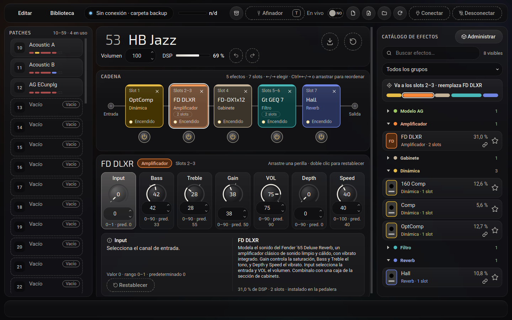

# JMC Guitar Zoom

Editor de escritorio para la pedalera de guitarra **Zoom A1 FOUR**, escrito en Python con PySide6 (Qt). Permite
editar patches con una cadena de efectos visual, escuchar los cambios en vivo, administrar los efectos de la
pedalera y conservar copias de seguridad, todo desde el ordenador.

> **No oficial.** JMC Guitar Zoom es un proyecto independiente. No lo desarrolla, respalda ni da soporte Zoom
> Corporation, y no está afiliado a [mungewell/zoom-zt2](https://github.com/mungewell/zoom-zt2), el proyecto del que
> deriva su código de protocolo (véase [NOTICE.md](NOTICE.md)). «Zoom», «A1 FOUR» y «Guitar Lab» son marcas de sus
> propietarios. Úselo bajo su propia responsabilidad y haga una copia de seguridad de la pedalera antes de empezar.

Versión en inglés: [README.md](README.md).



## Funciones

- **Editor de patches.** Los 50 patches de usuario de la pedalera en una lista; cada patch como una cadena de
  efectos con perillas para cada parámetro, interruptor de encendido por efecto, arrastrar y soltar para
  reordenar, deshacer y rehacer por patch, medidores de DSP y de memoria, y un catálogo de efectos con búsqueda y
  favoritos.
- **Edición en vivo.** Con «En vivo» activado, los cambios de parámetros y de encendido se envían a la pedalera
  mientras se edita.
- **Afinador.** El afinador de la pedalera en pantalla (la pedalera queda muda mientras está encendido).
- **Biblioteca y copias de seguridad.** Lectura de todos los patches, escritura de uno o de todos, importación y
  exportación de archivos `.zptc`, copia de seguridad de los patches y de los archivos de la pedalera. Cada
  escritura va precedida de una copia y seguida de una verificación por relectura.
- **Banco de patches.** Guarda patches fuera de la pedalera y los carga en cualquier posición; el patch de una
  posición ocupada pasa antes al banco. Nada se borra definitivamente (lo eliminado va a una papelera).
- **Administrador de efectos.** Instala, quita y repara efectos de la pedalera (la misma subida de archivos y
  actualización de la lista que hace Guitar Lab), muestra qué efectos instalados no usa ningún patch («Sin uso»),
  libera memoria y filtra por modelo de pedalera.
- **Actualizador de la biblioteca.** Consulta el canal público de Guitar Lab de Zoom en busca de efectos nuevos o
  actualizados y de versiones de firmware más recientes; descarga y verifica los efectos en la biblioteca propia
  de la aplicación. El firmware nunca se descarga ni se instala.
- **Listas según la pedalera.** El catálogo del editor solo muestra lo que la pedalera de destino puede ejecutar.
- **Interfaz en español.** Textos, descripciones de efectos y explicaciones de parámetros en español.

## Hardware compatible

| Pedalera | Compatibilidad |
|---|---|
| Zoom **A1 FOUR** | Edición completa. Protocolo verificado con el firmware 1.01. |
| Otros modelos de Zoom (G1 FOUR, G5n, ...) | Se detectan, pero son de **solo lectura**: no se les escribe nada. |

Solo se ha probado la A1 FOUR. La escritura está bloqueada a propósito para cualquier otro modelo.

## Seguridad

- **Haga siempre una copia de seguridad** antes de experimentar (Biblioteca > copia de seguridad). La aplicación
  también guarda el contenido anterior de un slot antes de sobrescribirlo, pero una copia hecha por usted es lo
  más seguro.
- Solo se escribe en la pedalera después de la copia, y los datos se vuelven a leer y se comparan.
- **El firmware no se gestiona.** El actualizador únicamente avisa de que existe una versión más reciente; para
  actualizar el firmware use las herramientas de Zoom.
- Los archivos de efectos y las listas de Guitar Lab son de Zoom. Este repositorio no incluye ninguno; el
  actualizador los descarga del servidor público de Zoom para su uso personal.

## Instalación

### Descarga

Cada versión se publica en la [página de Releases](https://github.com/cruceno/jmc-guitar-zoom/releases):

- **Linux:** `JMC_Guitar_Zoom-<versión>-x86_64.AppImage`, un solo archivo que no requiere instalación. Márquelo
  como ejecutable (`chmod +x JMC_Guitar_Zoom-*.AppImage`, o Propiedades > Permisos en el administrador de archivos) y
  ábralo. Si no arranca porque el sistema no tiene FUSE, ejecútelo con `--appimage-extract-and-run`.
- **Windows:** `JMC_Guitar_Zoom-<versión>-Setup.exe`. Se instala solo para su usuario, sin permisos de
  administrador, y agrega un acceso directo en el menú Inicio y un desinstalador. El instalador no tiene firma
  digital, así que la primera vez Windows SmartScreen muestra «Windows protegió su PC»: elija **Más información** >
  **Ejecutar de todas formas**.

La aplicación instalada guarda sus datos (copias, banco de patches, biblioteca de efectos) en
`~/.local/share/JMC Guitar Zoom` en Linux y en `%APPDATA%\JMC Guitar Zoom` en Windows. Lee la caché de efectos de
Guitar Lab, si existe, desde `%APPDATA%\GL` en Windows o desde un prefijo de Wine o Bottles en Linux, y nunca
escribe allí.

### Desde el código fuente

Necesita Python 3.12 o 3.13 y [uv](https://docs.astral.sh/uv/).

```sh
git clone https://github.com/cruceno/jmc-guitar-zoom.git
cd jmc-guitar-zoom
uv sync
uv run python -m jmc_guitar_zoom
```

En el primer arranque el catálogo de efectos está vacío si no tiene archivos de Guitar Lab: use el actualizador
(menú Biblioteca > «Actualizar biblioteca de efectos…») para descargar los efectos de su pedalera, o indique
carpetas con archivos `.zd2` mediante `--catalog [ETIQUETA=]CARPETA`.

Opciones útiles: `--no-connect` (no conectar con la pedalera) y `--offline CARPETA` (abrir una carpeta de copias
`NNN.zptc`).

Desde el código fuente, los datos (copias automáticas, banco de patches, biblioteca de efectos) se guardan en
carpetas **junto a la carpeta del repositorio** (`../patches`, `../library`), no dentro de ella, y también se lee
`../guitarlab/GL`.

### Linux y MIDI

La pedalera aparece como dispositivo MIDI USB a través de ALSA, y `python-rtmidi` se comunica con ella. El usuario
necesita acceso a los dispositivos de sonido (normalmente, el grupo `audio`). Cierre Guitar Lab (o Wine) y
cualquier otro programa que use el puerto MIDI de la pedalera antes de conectar: solo un programa puede usarlo a
la vez.

## Pruebas

La batería se ejecuta sin pantalla (sin display, sin MIDI, sin pedalera):

```sh
QT_QPA_PLATFORM=offscreen uv run pytest
```

Usa fixtures sintéticos generados en `tests/support/`, de modo que funciona en una copia limpia. Algunas pruebas
comparan esos fixtures con los archivos reales de Zoom; están marcadas con `zoom_files` y se omiten salvo que
descargue los archivos una vez:

```sh
uv run python scripts/fetch_test_fixtures.py
```

Ese script usa el actualizador de la propia aplicación para traer unos pocos efectos y la lista de efectos del
canal público de Zoom a `tests/.zoom-fixtures/` (ignorada por git). Las pruebas nunca usan la red ni tocan una
pedalera.

## Estructura del proyecto

```
jmc_guitar_zoom/
  device/    transporte MIDI, protocolo SysEx, cliente de la pedalera
  patches/   modelo .zptc, lectura y construcción, edición, copias, banco de patches
  effects/   catálogo de efectos (.zd2), modelos de pedalera, FLST_SEQ.ZT2, instalador, textos en español
  library/   actualizador del canal público de Guitar Lab
  ui/        widgets Qt, pantallas, tema, hilos de trabajo
tests/       la batería de pruebas y sus generadores de fixtures (tests/support)
scripts/     el script de descarga de fixtures (y los scripts auxiliares del proyecto original)
docs/        guía de usuario (es), arquitectura, notas de protocolo, capturas
```

Más información: [guía de usuario](docs/user-guide.es.md), [arquitectura](docs/architecture.md) (en inglés),
[notas de protocolo](docs/protocol-a1four.md) (en inglés), [contribuir](CONTRIBUTING.md).

## Créditos y licencia

Licencia MIT, véase [LICENSE](LICENSE). Es un derivado independiente de
[mungewell/zoom-zt2](https://github.com/mungewell/zoom-zt2) (MIT, Copyright (c) 2019 mungewell), cuya ingeniería
inversa del protocolo SysEx y de los formatos de archivo de la pedalera es la base de este trabajo. La aplicación
se desarrolló con ayuda de IA; nada de ello se propone al proyecto original, por respeto a su
[política sobre contribuciones de IA](ai.md). Componentes y fuentes de terceros:
[THIRD_PARTY_NOTICES.md](THIRD_PARTY_NOTICES.md).
