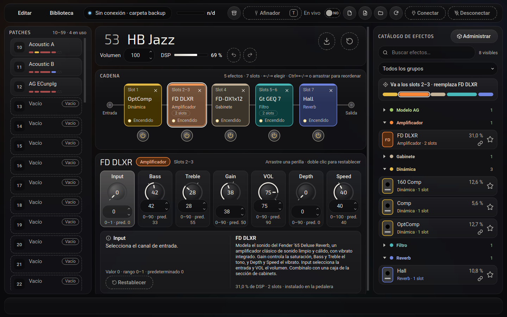

# JMC Guitar Zoom

A desktop editor for the **Zoom A1 FOUR** guitar pedal, written in Python with PySide6 (Qt). Edit patches with a
visual signal chain, hear the changes live, manage the pedal's effects and keep safe backups, all from your
computer.

> **Unofficial.** JMC Guitar Zoom is an independent project. It is not made, endorsed or supported by Zoom
> Corporation, and it is not affiliated with [mungewell/zoom-zt2](https://github.com/mungewell/zoom-zt2), the project
> its protocol code derives from (see [NOTICE.md](NOTICE.md)). "Zoom", "A1 FOUR" and "Guitar Lab" are trademarks of
> their owners. Use it at your own risk and back up your pedal first.

Spanish version: [README.es.md](README.es.md). The interface of the application is in Spanish.



## Features

- **Patch editor.** The 50 user patches of the pedal as a list; each patch as a signal chain of effect tiles with
  knobs for every parameter, an on/off switch per effect, drag and drop to reorder, undo and redo per patch, DSP
  and memory meters, and a searchable effect catalog with favourites.
- **Live edit.** With "En vivo" on, parameter and on/off changes are sent to the pedal while you edit.
- **Tuner.** The pedal's tuner shown on screen (the pedal is muted while it is on).
- **Librarian and backups.** Read all patches, write one or all of them, import and export `.zptc` files, back up
  the patches and the pedal's files. Every write is preceded by a backup and followed by a read-back check.
- **Patch bank.** Keep patches outside the pedal and load them into any position; an occupied position's patch goes
  to the bank first. Nothing is deleted for good (removed entries go to a trash folder).
- **Effects manager.** Install, remove and repair effects on the pedal (the same file upload and list update Guitar
  Lab does), see which installed effects no patch uses ("Sin uso"), free the pedal's memory, and filter by pedal
  model.
- **Library updater.** Checks Zoom's public Guitar Lab channel for new or updated effects and newer firmware
  versions, downloads and verifies the effect files into the application's own library. The firmware itself is
  never downloaded or flashed.
- **Pedal-aware lists.** The editor catalog only shows what the target pedal can run.
- **Spanish interface.** Texts, effect descriptions and parameter explanations are in Spanish.

## Supported hardware

| Pedal | Support |
|---|---|
| Zoom **A1 FOUR** | Full editing. Protocol verified on firmware 1.01. |
| Other Zoom models (G1 FOUR, G5n, ...) | Detected, but **read-only**: nothing is written to them. |

Only the A1 FOUR has been tested. The write paths are deliberately blocked for every other model.

## Safety

- **Always back up** before experimenting (Biblioteca > copia de seguridad). The application also saves the
  previous content of a slot before it overwrites it, but a backup you made yourself is the safest.
- The pedal is written only after the backup, and the data is read back and compared.
- **Firmware is not handled.** The updater only tells you that a newer version exists; use Zoom's own tools to
  update the firmware.
- The effect files and Guitar Lab lists are Zoom's. This repository does not contain any; the updater downloads
  them from Zoom's public server for your own use.

## Install

You need Python 3.12 or 3.13 and [uv](https://docs.astral.sh/uv/).

```sh
git clone https://github.com/cruceno/jmc-guitar-zoom.git
cd jmc-guitar-zoom
uv sync
uv run python -m jmc_guitar_zoom
```

On first start the effect catalog is empty if you have no Guitar Lab files: use the library updater (menu
Biblioteca > "Actualizar biblioteca de efectos…") to download the effects for your pedal, or pass folders of `.zd2` files with
`--catalog [LABEL=]DIR`.

Useful options: `--no-connect` (do not talk to the pedal), `--offline DIR` (open a folder of `NNN.zptc` backups).

Data (autosave backups, the patch bank, the effect library) is kept in folders **next to the repository folder**
(`../patches`, `../library`), not inside it.

### Linux and MIDI

The pedal appears as a USB MIDI device through ALSA; `python-rtmidi` talks to it. The user needs access to the
sound devices (normally the `audio` group). Close Guitar Lab (or Wine) and any other program that holds the pedal's
MIDI port before connecting: only one program can use it at a time, and the pedal must not be in another mode.

## Tests

The suite runs offscreen (no display, no MIDI, no pedal):

```sh
QT_QPA_PLATFORM=offscreen uv run pytest
```

It uses synthetic fixtures generated in `tests/support/`, so it runs on a clean checkout. A few tests compare the
synthetic fixtures with Zoom's real files; they are marked `zoom_files` and skipped unless you download the files
once:

```sh
uv run python scripts/fetch_test_fixtures.py
```

That script uses the application's own updater to fetch a handful of effects and the effect list from Zoom's public
channel into the git-ignored `tests/.zoom-fixtures/`. The tests themselves never use the network and never touch a
pedal.

## Project layout

```
jmc_guitar_zoom/
  device/    MIDI transport, SysEx protocol, the pedal client
  patches/   .zptc model, parser/builder, editing, backups, the patch bank
  effects/   effect catalog (.zd2), pedal model list, FLST_SEQ.ZT2, installer, Spanish texts
  library/   the updater for Zoom's public Guitar Lab channel
  ui/        Qt widgets, screens, theme, worker threads
tests/       the test suite and its fixture factories (tests/support)
scripts/     the fixture download script (and upstream's helper scripts)
docs/        user guide (es), architecture, protocol notes, screenshots
```

More: [architecture](docs/architecture.md), [protocol notes](docs/protocol-a1four.md),
[user guide (Spanish)](docs/user-guide.es.md), [contributing](CONTRIBUTING.md).

The repository root also keeps the scripts of the upstream project (`zoomzt2.py`, `decode_*.py`, ...), which the
application imports for the container formats. Their original README is in
[docs/zoom-zt2-upstream-readme.md](docs/zoom-zt2-upstream-readme.md).

## Credits and licence

MIT licence, see [LICENSE](LICENSE). This is an independent derivative of
[mungewell/zoom-zt2](https://github.com/mungewell/zoom-zt2) (MIT, Copyright (c) 2019 mungewell), whose reverse
engineering of the pedal's SysEx protocol and file formats is the base of this work. The application was developed
with AI assistance; none of it is submitted upstream, out of respect for the upstream author's
[policy on AI contributions](ai.md). Third-party components and fonts: [THIRD_PARTY_NOTICES.md](THIRD_PARTY_NOTICES.md).
