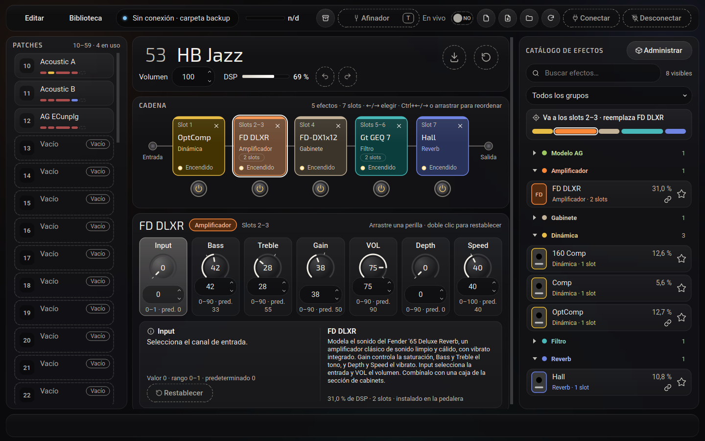
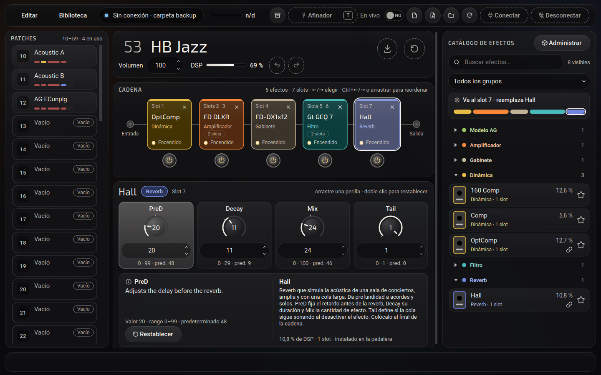

# Guía de usuario de JMC Guitar Zoom

JMC Guitar Zoom es un editor no oficial para la pedalera **Zoom A1 FOUR** (no afiliado a Zoom Corporation). Esta
guía recorre cada pantalla y función. Para instalar la aplicación (AppImage en Linux, instalador en Windows), véase
el [README](../README.es.md). La aplicación instalada guarda copias, banco y biblioteca en
`~/.local/share/JMC Guitar Zoom` (Linux) o `%APPDATA%\JMC Guitar Zoom` (Windows).

> **Antes de empezar:** haga una copia de seguridad de todos los patches (menú Biblioteca) y cierre Guitar Lab u
> otros programas que usen el puerto MIDI de la pedalera.

## 1. Conectar

1. Conecte la A1 FOUR por USB y enciéndala.
2. Pulse **Conectar** en la barra superior. La aplicación lee los patches (verá el avance en la barra de estado) y
   la etiqueta de conexión muestra el modelo y el firmware.
3. **Desconectar** cierra la conexión. Con otro modelo de Zoom, la aplicación lo reconoce pero lo trata como de
   **solo lectura**: se puede ver, pero no se escribe nada y un aviso lo indica.

Sin pedalera también se puede trabajar: **Abrir carpeta…** (barra superior o menú Biblioteca) abre una carpeta de copia de seguridad (archivos
`NNN.zptc`) y se edita sin conexión; para escribir en la pedalera hay que conectar. En la línea de comandos,
`--offline CARPETA` y `--no-connect` hacen lo mismo al arrancar.

## 2. La pantalla del editor

De izquierda a derecha:

- **Lista de patches.** Los 50 patches de usuario (numerados 10 a 59 como en la pedalera) con su nombre y unas barras
  de colores que resumen los grupos de efectos. Los patches con cambios sin guardar se marcan como «Editado».
- **Cadena.** El patch como una cadena de efectos, de «Entrada» a «Salida». Cada ficha muestra el slot, el nombre, el
  grupo y si está encendido; los efectos anchos ocupan dos slots. Debajo de cada ficha, un botón de encendido.
  Seleccione una ficha con el ratón o con las flechas ←/→; reordene arrastrándola o con Ctrl+←/→; quite un efecto con la
  × de la ficha.
- **Parámetros.** Las perillas del efecto seleccionado: arrastre una perilla o escriba el valor; doble clic
  la restablece al valor predeterminado. Debajo se muestran la explicación del parámetro y la descripción del efecto.
- **Cabecera del patch.** Número y nombre (se edita), volumen, medidor de **DSP** (los patches que superan el 100 % no
  caben en la pedalera), deshacer y rehacer (cada patch guarda su propio historial).
- **Catálogo de efectos.** A la derecha, agrupado y con búsqueda. Para añadir o cambiar un efecto, selecciónelo y
  use el botón, Enter o doble clic, o arrástrelo a un slot vacío. La estrella marca favoritos. El catálogo solo
  muestra lo que la pedalera de destino puede ejecutar.

Los iconos de las fichas indican si el efecto **está instalado en la pedalera** y si **está en la cadena**. Una ficha
roja, «No funciona en la A1 FOUR», marca un efecto que esa pedalera no puede ejecutar o que no está instalado.

### Guardar y descartar

- **Guardar en la pedalera** (icono de guardar en la cabecera): hace copia de seguridad del slot, escribe el patch y
  lo vuelve a leer para comprobarlo. Si el patch usa efectos que la pedalera no tiene, **no se puede guardar** hasta
  instalarlos (la ficha ofrece una instalación rápida).
- **Descartar cambios** (icono de actualizar, Ctrl+R): vuelve a la última versión guardada del patch.
- **Escribir en la pedalera todo lo editado** (menú Biblioteca) guarda todos los patches modificados de una vez.

## 3. Edición en vivo

Con el interruptor **En vivo** en «SÍ», los cambios de parámetros, de encendido, de volumen y de nombre del patch se
envían a la pedalera mientras edita, y se oye el resultado al instante. Esto no guarda nada en la memoria de la pedalera: para conservar el
cambio hay que guardar el patch. Si descarta los cambios, la pedalera vuelve a su valor anterior. Con «NO» solo
cambia lo que se ve en pantalla.

## 4. Afinador

El botón **Afinador** (o la tecla **T**) enciende el afinador de la pedalera y abre una pantalla con la nota y el
desvío: el centro es «AFINADO». **La pedalera queda muda mientras el afinador está encendido.** «Salir del afinador» o
la tecla T lo apagan. La pedalera informa el desvío en 15 pasos (de −7 a +7), no en cents: sirve para afinar, pero no
para medir la octavación.

### Calibración (placa de audio)

La pantalla **Calibración** reúne los cuatro ajustes de una guitarra en el orden en que conviene hacerlos y mide la
nota directamente desde una placa de sonido, con una décima de cent de resolución. No necesita la pedalera conectada.

- **Abrirla:** el botón del puente en la barra superior (aparece cuando hay lugar), **Biblioteca > Calibración…** o la
  tecla **O**. «Cerrar» o la tecla O la cierran. La pantalla recuerda el último paso en que estaba; la primera vez
  abre en el paso 1.
- **Pasos:** «1 Curvatura del mástil», «2 Acción», «3 Pastillas» y «4 Octavación». Se puede ir a cualquiera, pero el
  **orden recomendado es curvatura → acción → pastillas → octavación**: la octavación va última porque las otras la
  cambian. Cambiar la curvatura o la altura de las cuerdas mueve la afinación del traste 12, y la altura de las
  pastillas puede tirar de las cuerdas y desafinarlas.
- **Entrada:** elija el dispositivo y el canal donde llega la guitarra: directo a la entrada de instrumento de la placa,
  o la salida de la pedalera conectada a la placa. Sirve cualquier placa que el sistema reconozca y la aplicación
  recuerda la elección. El medidor de nivel avisa si la señal satura (baje la ganancia) o es baja (súbala): el nivel
  importa más que los bits del conversor.
- **Afinador:** la nota, la octava, los cents con un decimal y la frecuencia se ven siempre, en cualquier paso (después
  de cada ajuste hay que volver a afinar); «Estable» aparece cuando la nota dejó de moverse después del ataque.
- **Presets:** en los pasos 1 a 3, el selector **Estilo de guitarra** ofrece «Estilo Fender (simple)», «Estilo Gibson
  (humbucker)» y «Personalizado». Son **valores típicos de partida, no especificaciones de fábrica**: cada guitarra y
  cada estilo de toque piden los suyos. Los objetivos de cada paso se pueden editar; al hacerlo, el selector pasa a
  «Personalizado» con esos valores, y la aplicación los recuerda.

#### Paso 1: curvatura del mástil

La curvatura es la flexión hacia delante del mástil. **Método:** ponga una cejilla en el traste 1, pise la cuerda 6 en
el traste donde el mástil se une al cuerpo y mida con una galga la luz entre la cuerda y el traste 7 u 8. Escriba la
medida en mm (de 0,00 a 2,00). La aplicación la compara con el objetivo del preset y dice si está bien o si hay que
**apretar** la tuerca del alma (sentido horario, si hay demasiada luz) o **aflojarla** (sentido antihorario, si falta).
El dibujo muestra el mástil de lado con la curvatura exagerada (la medida en línea llena, el objetivo en línea de
trazos) y la tuerca con una flecha curva del giro. **Como máximo 1/8 de vuelta por vez; afine y espere unos minutos
antes de medir de nuevo.** Si la tuerca del alma no gira con facilidad, no la fuerce: consulte a un luthier.

#### Paso 2: acción

La acción es la altura de la cuerda sobre el traste 12. **Método:** mida desde el borde superior del traste 12 hasta
la parte inferior de la cuerda. Las cuerdas 6 y 1 son necesarias; las demás son opcionales (el objetivo de las del
medio se interpola entre los de la 6 y la 1). Para cada cuerda medida, la aplicación dice si la acción está en el
objetivo o cuánto **subir o bajar la selleta**: el traste 12 está a la mitad de la escala, así que la selleta se mueve
**unas 2 veces el error medido**. Una vista de las seis selletas muestra una flecha por cuerda. Además se dibuja y
se escribe el **perfil de selletas** del radio del diapasón (7,25", 9,5", 12", 16"; el del preset, editable), por
ejemplo «Perfil de selletas para radio 9,5": cuerdas 4 y 3 +1,35 mm, cuerdas 5 y 2 +0,90 mm respecto de 6 y 1».

#### Paso 3: pastillas

La altura se mide con la cuerda pisada en el último traste, desde la parte superior del polo hasta la parte inferior
de la cuerda: la cuerda 6 del lado graves y la 1 del lado agudos. Elija la **posición del selector** (las del preset,
cada una con su tipo de pastilla: simple, humbucker o P-90), escriba las dos alturas y la aplicación dice, para cada
lado, si hay que subir o bajar la pastilla, con una flecha en el dibujo.

La **ayuda con audio** ayuda a verificar el resultado:

- **Medir balance:** toque cada cuerda al aire, de la 6 a la 1, con la misma fuerza. La aplicación pide «Ronda i de n ·
  Toque la cuerda s al aire» (el número de **Rondas** es el mismo de la octavación, de 3 a 10) y rechaza una nota que
  no es la cuerda pedida. Al final dibuja el nivel de cada cuerda respecto de la media, con su dispersión, y dice si
  los graves o los agudos suenan más fuerte (la diferencia tolerada es 2 dB) y qué pastilla bajar o subir. Si mide
  dos o más posiciones del selector, también compara una posición con otra y marca las que suenan más bajo.
- **Comprobar atracción magnética:** pise la cuerda 6 en el traste 15 y déjela sonar. Si la nota ondula, es decir, si el
  tono oscila más de 4 cents, la pastilla puede estar demasiado cerca de la cuerda: la aplicación avisa y sugiere bajar
  el lado graves.

#### Paso 4: octavación

**Octavación estadística, cuerda por cuerda.** Una sola toma mide también el pulso de quien toca, así que la
herramienta pide **rondas** repetidas y juzga con la media y su incertidumbre, para no calibrar ruido. Elija la
cuerda (empieza por la 6), el número de **Rondas** (de 3 a 10; 5 por defecto, la aplicación recuerda la elección) y
siga los pasos; cada nota se toma sola cuando está estable, así que las manos quedan en la guitarra. Cada ronda pide
tres notas, siempre en este orden:

1. **Al aire:** toque la cuerda al aire y déjela sonar. Desde la ronda 2 debe sonar casi igual que en la ronda 1; si
   la cuerda está desafinada más de 5 cents, la pantalla lo avisa.
2. **Armónico 12:** toque el armónico del traste 12 de la misma cuerda.
3. **Traste 12:** pise la cuerda en el traste 12, sin apretar de más, y déjela sonar.

Una nota que no es la esperada (por ejemplo, la cuerda al aire cuando toca el armónico) se rechaza con un aviso, y
solo cuenta una nota nueva: no hace falta esperar a que la anterior se apague. «Pulse siempre con la misma fuerza,
suave»: un ataque fuerte sube la nota en el primer instante.

**Qué muestra.** En cada ronda se compara el traste 12 con el armónico (el desvío del veredicto), el traste 12 con el
doble de la cuerda al aire y el armónico con el doble de la cuerda al aire (control cruzado). El gráfico de puntos
dibuja un punto por toma, la media con su intervalo de confianza del 95 % (t de Student) y la banda de tolerancia
sombreada. Además se ve la **repetibilidad del toque** (desvío estándar en cents de cada tipo de nota, a partir de la
segunda ronda) y, desde la tercera, **Desvío: media ± intervalo cents**. Si el armónico y la cuerda al aire difieren
más de 1,5 cents de media, la pantalla avisa: la afinación se movió o el toque no es parejo.

**Tres veredictos** frente a la tolerancia (±1 cent si no elige otra):

- **En tolerancia:** todo el intervalo cae dentro de la tolerancia; la selleta está bien y el puente muestra una marca.
- **Mover la selleta:** todo el intervalo cae fuera. Solo entonces el puente dibuja una flecha **hacia el mástil** si el
  traste 12 está bajo o **alejándose del mástil** si está alto, y los mm salen de la media según la escala elegida
  (628, 635, 648 o 650 mm).
- **No concluyente:** el intervalo cruza el borde de la tolerancia (la dispersión es comparable al desvío). El puente
  muestra un «?» y no hay que mover la selleta todavía: repita la medición o mejore el toque.

**Botones.** **Repetir última toma** descarta la última nota tomada (la del paso anterior de la ronda, o la última de
la ronda anterior) y la pide otra vez, por ejemplo cuando una nota salió mal. **Medir de nuevo** reinicia la cuerda
desde la ronda 1, por ejemplo después de mover una selleta y afinar. **Siguiente cuerda** pasa a la próxima que falte
medir o que no esté en tolerancia (una «no concluyente» también cuenta como pendiente). Se comparan notas de la misma
entrada, así que el resultado no depende del La de referencia ni del reloj de la placa. Con un sonido limpio, la
precisión de cada toma ronda ±0,5 cent.

## 5. Biblioteca: copias, archivos y banco

El menú **Biblioteca** reúne:

- **Copia de seguridad de todos los patches** y de **patches y archivos de la pedalera**: crean una carpeta con la fecha.
- **Exportar** el patch seleccionado o todos, e **importar** un archivo `.zptc` en el slot seleccionado o una carpeta de
  copia. Antes de escribir, la aplicación pide confirmación.
- Copiar, pegar, intercambiar y vaciar slots (vaciar escribe el patch «Empty» de fábrica).
- **Banco de patches…**, **Instalar o quitar efectos…** y **Actualizar biblioteca de efectos…** (secciones siguientes).

Toda escritura en la pedalera sigue el mismo camino seguro: copia automática del contenido anterior, escritura y
verificación por relectura.

## 6. Banco de patches

El botón **Banco** abre una pantalla con dos listas: **En la pedalera** (las posiciones) y **En el banco** (los patches
guardados fuera de la pedalera, con su nombre, posición de origen y fecha; hay búsqueda).

- **Guardar en el banco y liberar:** guarda el patch de una posición en el banco y deja la posición vacía.
- **Cargar en la posición…:** carga un patch del banco en la posición que elija. Si está ocupada, el patch que había
  pasa antes al banco y solo después se escribe el nuevo; la entrada se quita del banco una vez verificada la lectura.
- También se puede **arrastrar** en ambos sentidos entre las dos listas.
- **Renombrar** (F2) y **Eliminar** (Supr) trabajan sobre el banco; eliminar no borra: mueve el archivo a la
  carpeta `papelera`. Ninguna de las dos acciones toca la pedalera.

Mientras haya cambios sin guardar, no haya conexión o haya una operación en curso, el banco bloquea las acciones que
escriben. Si algo falla, queda una copia duplicada en el banco: es el lado seguro.

## 7. Efectos de la pedalera

**Efectos** (o Biblioteca > «Instalar o quitar efectos…») abre el administrador. Requiere conexión y bloquea la
edición de patches mientras está abierto.

- **Instalados** y **Disponibles para instalar:** las dos listas, con búsqueda y filtro por grupo. Al seleccionar un
  efecto se ven su explicación, su tamaño, su carga de DSP y las acciones posibles.
- **Instalar:** sube el archivo del efecto y marca su indicador en la lista de la pedalera (lo mismo que hace Guitar
  Lab). Antes de escribir se hace copia de la lista y se comprueba que hay memoria libre suficiente.
- **Quitar:** solo se puede quitar un efecto que ningún patch use; la pantalla muestra qué patches lo usan o que el
  uso no está confirmado (hay que haber leído todos los patches y no tener ediciones sin guardar).
- **Sin uso:** en el filtro de grupo, la opción «Sin uso» muestra solo los efectos instalados que ningún patch usa, y
  permite quitar varios de una vez para liberar memoria.
- **Reparar:** si la lista de la pedalera marca un efecto como instalado pero falta su archivo («Falta el archivo»),
  Reparar vuelve a subir solo ese archivo, si hay una copia local.
- **Filtro de pedalera:** el selector de pedal muestra los efectos de otro modelo (se pueden consultar, pero solo se
  instala en los modelos compatibles).
- La barra de **Memoria** de la parte superior avisa cuando queda poca («Memoria baja», «Memoria crítica»).

## 8. Actualizador de la biblioteca de efectos

**Biblioteca > Actualizar biblioteca de efectos…** consulta el canal público de Guitar Lab de Zoom y compara con los
efectos que ya tiene:

- **Nuevos** y **Actualizados**: se listan con su tamaño; marque los que quiera y pulse **Descargar**. Cada archivo se
  verifica (que sea un efecto válido, con el identificador anunciado y una versión igual o posterior a la anunciada)
  antes de guardarse en la biblioteca de la aplicación. Nunca se sobrescribe un archivo existente. **Cancelar** detiene la descarga tras el
  efecto en curso.
- **Todos los modelos** incluye los efectos de todas las pedaleras que Zoom publica, no solo de la elegida.
- Muestra también si Zoom publica un **firmware** más reciente que el de su pedalera. El firmware no se descarga ni se
  instala desde esta aplicación: use las herramientas de Zoom.
- La consulta se hace al arrancar (como máximo una vez al día, solo con internet) y bajo demanda; si hay novedades,
  aparece un aviso con «Ver».

Los archivos descargados son de Zoom y se guardan solo en su equipo, para su uso personal.

## 9. Problemas frecuentes

- **No conecta:** cierre Guitar Lab y cualquier programa que use la pedalera; reconecte el USB; en Linux, compruebe
  que su usuario pertenece al grupo `audio`.
- **No aparecen entradas de audio:** conecte la placa y pulse el botón de buscar entradas de nuevo. En Linux la
  aplicación usa PulseAudio o PipeWire (biblioteca `libpulse`).
- **La nota no se estabiliza:** suba la ganancia si el medidor marca señal baja, apague los efectos de modulación y
  deje sonar la cuerda sin tocar las demás.
- **El catálogo está vacío:** use el actualizador, o indique carpetas con archivos `.zd2` con `--catalog`.
- **No se puede guardar:** el mensaje indica el motivo (efectos no instalados, patch demasiado grande, modelo de solo
  lectura, sin conexión).
- **Algo salió mal al escribir:** las copias automáticas están en la carpeta `patches/autosave` junto al repositorio;
  los archivos `.zptc` se pueden volver a importar.
